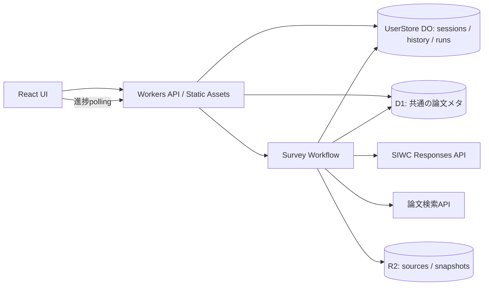

# 0001: 研究サーベイMVP

状態: Ready（開発方針採用、製品機能未実装）
日付: 2026-10-12 JST
関連: [受け入れ条件](../acceptance.md)、[ADR](../adr/README.md)、[SIWC](../siwc-feasibility.md)

2026-10-12のユーザー指示により、まず[UI＋DSL調整PoC](0002-ui-dsl-codex-poc.md)を作り、AgentはCodexを使う。以下はCloudflare MVPの目標設計。PoCではローカルCodexとブラウザ保存を使い、Cloudflareの実認証を先行開発の前提にしない。

2026-10-12の追加の指示で、利用者はSign in with ChatGPTで作る複数の利用者になり、保存を利用者ごとのDurable Object（SQLite）とR2のprefix、共通の論文メタD1に分けた。デプロイの構成と順番は[0028](0028-cloudflare-deploy.md)を正本とし、この文書の単一利用者・Cloudflare Access・D1を履歴の正本とする記述を置き換える。

## 目的と範囲

自然言語で研究テーマを入力し、出典付きのIssue・Method・Paper・Claimを生成する。ユーザーはチャットで差分を追加し、過去の版を復元し、任意の版からForkして編集できる。調査はブラウザを閉じても継続する。

MVPの利用者はSIWCで作る複数の利用者（[0028](0028-cloudflare-deploy.md)）。Issue Explorer、Issue×Method Matrix、Paperカードの3ビューを実装する。LLM/MAPF/Roboticsで共通のモデルを使い、MAPFは受け入れ試験の例とする。

Subgraph ForkもMVPタスクに含める。マージの親を複数保存できるモデルを先に用意するが、自動マージ、Method Evolution、Paper Landscape、専用Claimビュー、Text DSL、定期更新は後続。Method Evolutionはユーザー指示により[PoCのP02](0003-method-evolution.md)で先行実装した。ClaimとEvidenceの詳細はMVPのInspectorで確認できる。

## 現在と移行

現在の `src/worker.mjs`、`public/`、`lib/siwc.mjs`、`scripts/`、`test/` はPoC。READMEにローカルOAuthと実推論の成功記録がある。公開WorkerのOAuth、更新可能なセッション、製品の保存・調査・可視化はない。

単一リポジトリ内でwebとworkerを分け、共有ドメインをpackagesに置く。npm workspacesを機能追加時に導入する。Turbo/Nxや別サービスへの分割は現時点で不要。既存ファイルの一括移動は避け、移行PRでコマンド・テスト・Wrangler設定を揃える。

```text
apps/
  web/                 React + TypeScript + Vite、3ビューとチャット
  worker/              API、認証、Workflowエントリ、Wrangler設定
packages/
  domain/              JSON Schema、グラフ、Patch、Commit/Forkの純粋関数
  agent/               計画・検索・抽出・検証・合成、モデル/検索のport
  adapters/            SIWC HTTP、文献API、D1、R2実装
migrations/            D1の番号付きSQL
test/                  既存PoC回帰試験、後に統合試験
docs/                  設計、ADR、タスク、実測、手順
scripts/               ローカルSIWCと開発チェック
```

上は移行先の設計であり、現在存在する構成ではない。空のpackageは作らず、最初の利用コードと一緒に追加する。新規TSの型と実行時validatorは一つのJSON Schemaから生成し、二重管理を避ける。型生成手段はB02で実験してADRに追記する。

## Cloudflare構成



Workers Static Assetsからwebを配信する。APIとWorkflowは同じアプリ内に置く。利用者のDurable Objectを履歴とrunの正本、R2を原文・大きなsnapshotの保存先、D1を共通の論文メタとする。MVPは進捗pollingを使い、DO/WebSocketやQueuesは必要になった段階でADRを作る。更新時の短いpoll間隔と、非表示タブ時の間隔延長を実装する。

[Workflows](https://developers.cloudflare.com/workflows/) の永続ステップとretryを使う。各ステップの上限、保存容量、実行上限は導入時に公式制限とユーザーのプランで確認する。

## 認証境界

利用者はSIWCのサインインで作り、APIはセッションのuidで利用者のDurable Objectへ振り分ける（[0028](0028-cloudflare-deploy.md)、[ADR 0018](../adr/0018-siwc-user-accounts.md)）。Cloudflare AccessはOpenAIの承認前のstagingで本人だけを通す仮の手段に限り、Workerでもissuer/audience/署名/期限を検証する。サインインとSIWCのプラン利用の許可は別の状態として表示する。

SIWCのCloudflare運用は未確定。[実現性文書](../siwc-feasibility.md)とB01で、対象条件と許可された認可経路を確認する。公開HTTPS callbackの対応を推測しない。成立した経路に合わせて認証の詳細design docを追加する。

保存時はAES-GCMで資格情報を暗号化し、鍵はWorker Secret、暗号文・nonce・key_versionをD1に保存する設計。ブラウザはHttpOnly/Secure/SameSite cookieだけを持つ。更新はセッション単位で排他し、旧refresh tokenの再利用を防ぐ。外部更新と保存の間のクラッシュは再認可が必要な状態として扱う。固定SIWC_ACCESS_TOKENによるPoC運用を本番セッションと混同しない。

## グラフとPatch

Snapshotは `schema_version`、entities、relations、引用数の再現用値を含む。IDは表示名から独立した安定ID。Domain、Concept、Issue、Method、Paper、Claim、Evidenceを第一級の型にする。

Issueのkindは fundamental / subproblem / method_dependent。解決状態はClaimに持たせ、open / partially_solved / solved / disputed / unknown と scope、as_of、Evidenceを保存する。複数親を許し、part_ofの循環は禁止する。他の関係種別の循環制約は型ごとに決める。

Paperはhandoffの必須フィールドを保持する。取得できないyear/venue等はnullと取得状態で表し、生成値を埋めて確定情報にしない。引用数未取得はnullで、0と区別する。ClaimのscopeにTask/Setting/Metric/Assumption/Limitationを保持する。Evidenceは原文URL、取得日時、ページ/節/段落、断片hash、検証状態を持つ。abstractしか取得していない場合は本文検証済みとしない。

Patchは `base_commit_id`、schema_version、operationsを持つ。MVPの操作はentity/relationのadd・update・remove。削除は明示要求がある場合のみ、参照整合性を検証する。任意JSONPathの更新は許可しない。入力schema、ID重複、参照、関係の型、Evidence、scopeを検証してから適用する。

## 保存と不変性

保存先は[0028](0028-cloudflare-deploy.md)と[ADR 0019](../adr/0019-per-user-storage-and-shared-paper-meta.md)で分けた。下の表のうち論文の固定情報と引用数（papers、paper_live_metadata）は共通の論文メタD1、ほかは利用者のDurable ObjectとR2の `users/{uid}/` に置く。LLMの要点は共通にしない。

| 保存対象 | 主なデータ |
| --- | --- |
| surveys / branches | owner、source_survey/source_commit、head_commit |
| commits / commit_parents | snapshot hash、schema_version、author、run、message、複数親 |
| changesets / chat_messages | base、typed Patch、元指示、適用結果 |
| agent_runs / run_events | owner、base、idempotency key、状態、段階、試行、checkpoint |
| source_artifacts / snapshots | R2 key、hash、取得日時、利用範囲。論文以外のソースの原文とURL |
| papers / paper_records / paper_files | 調査をまたぐ論文ライブラリ。DSLで検証したPaper・Claim・Evidence、PDF・mdのR2 key（[0010](0010-paper-library.md)） |
| paper_live_metadata | 最新引用数、source、as_of（Commitから分離） |
| sessions / oauth_transactions | 暗号化資格情報、TTL、使用済み状態、更新lease |

R2へ内容hashでimmutable snapshotを書き、次に利用者のDurable Objectの1つのtransactionでCommitの追加とbranch headの比較・更新を確定する。baseが違えば全体を失敗させる。先に読んでから無条件UPDATEしない。当初案のD1の[batch](https://developers.cloudflare.com/d1/worker-api/d1-database/)はUPDATEの0件更新がエラーにならず、guardが要った。具体SQLと競合試験をC03で確定する。

R2とDurable Objectは一つのトランザクションではない。確定の失敗時の孤立snapshotは許容し、参照されないものだけ後で削除する。存在しないR2 snapshotを参照するCommitは作らない。runごとに最大1件の確定CommitをDB制約で保証する。

Forkは選択Commitを起点に新survey/branchを作り、元Commitを変更しない。Subgraph Forkは対象Issue/Methodから階層子と関連Paper/Claim/Evidenceを選び、参照先の依存閉包を含める。related_to等で無制限に全グラフへ広げず、採用関係と最大件数を明示する。選択・閉包ルールの詳細はB06の設計で固定する。

## APIの案

すべて `/api` 配下。認証方式確定後にlogin/callback/logoutを追加する。

| API | 動作 |
| --- | --- |
| POST /surveys | テーマ・冪等キーを受け、survey/runを作り202 |
| POST /surveys/:id/messages | branch/base_commitと指示から差分runを作り202 |
| GET /runs/:id | 状態、進捗、秘密を含まないerror code |
| GET /runs/:id/events?after= | cursorで段階イベントを取得 |
| POST /runs/:id/cancel | 終了状態と競合しない取消要求 |
| GET /surveys/:id/commits | 履歴 |
| GET /surveys/:id/commits/:commit | 再現用snapshot |
| GET /surveys/:id/diff?from=&to= | 型付き差分 |
| POST /surveys/:id/forks | source_commit、任意root_entityからFork |

owner違反は情報を漏らさない応答、base競合は409、未認証は401。入力サイズ、テーマ長、件数、1runの呼出回数/時間/保存量に上限を置く。課金方式を変えず、上限到達は再開可能な失敗として報告する。

## Agentの実行

Discovererはまず代表学会、次に代表サーベイ論文とawesomeレポジトリを並行して調べ、そこから一次論文へたどる。Retrieverは論文を読む前に論文ライブラリを照合し、保存済みならPDF・本文を読まない（[0010](0010-paper-library.md)）。[調査Prompt設計](0007-survey-discovery-prompt.md)に順序と確認項目を定める。

Planner→Discoverer→Retriever→Extractor→Verifier→Synthesizer→Validator→CommitterをWorkflowステップにする。検索APIとモデルはport経由で差し替え、偽の文献や固定MAPFデータを実調査結果と混ぜない。

run_idをWorkflow IDに使う。queued保存とWorkflow作成の間で失敗した場合は、未起動runを照合して再起動できる仕組みを持つ。再試行時にはcheckpointと成果物hashを確認し、重複保存・二重Commitを防ぐ。LLMの再呼出しは追加利用になるため、回数を制限する。

状態は queued/running/succeeded/failed/cancelled。base競合や再認可待ちはfailure_reasonで表現し、勝手に最新headへ適用しない。cancelはD1の取消要求を各ステップとCommit直前で確認し、DBの確定処理でも取消との競合を防ぐ。成功後のcancelでは成功状態を維持する。

## 検証と段階

B01で認証経路を実証し、B02で純粋ドメイン、B03でD1/R2、B04でWorkflow、B05で3ビューとチャット、B06で差分・Fork、B07でCloudflare受け入れを実施する。B01の外部確認待ちでもB02/B03とfixtureによる開発は進められる。

schema拒否、参照切れ、Claim出典、履歴不変、head競合、冪等、失敗/retry/cancel、再閲覧、OAuthと実推論を検証する。詳細は[受け入れ条件](../acceptance.md)。各段階で実装前に関連design docを作る。

## 未解決事項

- Cloudflareの個人運用に許されるSIWC経路と更新管理。最優先の外部依存。
- 文献APIのアクセス条件、利用上限、引用数source。検索adapter実装前に公式資料で確認。
- 全文PDF抽出の必要性。MVPのabstract/公開HTMLで不足した場合に検証し、Container導入は別ADR。
- グラフ件数、調査budget、poll間隔の具体値。縦断スライスで計測して決める。
