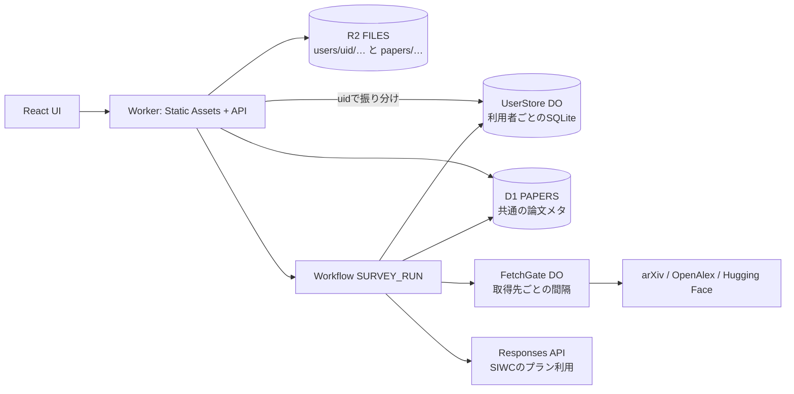

# 0028: Cloudflareへのデプロイ（複数の利用者・利用者ごとの保存・共通の論文メタDB）

状態: Draft
日付: 2026-10-12 JST
対象タスク: C00〜C08（[バックログ](../backlog.md)）
関連ADR・受け入れ条件: [ADR 0018](../adr/0018-siwc-user-accounts.md)、[ADR 0019](../adr/0019-per-user-storage-and-shared-paper-meta.md)、[ADR 0020](../adr/0020-agent-on-workflows-responses.md)、[MVP設計](0001-mvp.md)、[SIWC実現性](../siwc-feasibility.md)、[受け入れ条件](../acceptance.md)

## 目的と範囲

ユーザー指示（2026-10-12）：

- Cloudflareへデプロイする準備をして、順番を決める。
- 利用者の作成はSign in with ChatGPT（SIWC）で行う。
- 利用者ごとにDBとストレージを分ける。
- 論文のメタDBは全員で共通にする。LLMの揺れに依存せず、何度取っても変わらないものを入れる。取得は外部APIからでよい。

この文書は[MVP設計](0001-mvp.md)の「個人用の単一利用者」「Cloudflare Accessで入口を制限」「D1を履歴とrunの正本」を置き換える。ローカルPoC（[0002](0002-ui-dsl-codex-poc.md)）はそのまま動かし、同じ関数をCloudflareで使う。

## 外部の条件（2026-10-12に公式資料で確認）

- Webサイト向けのSIWC（本人確認のscope `openid profile email`）は、選ばれた商用パートナー向けの限定トライアル。waitlistに入り、client ID（`oaiapp_…`）と環境ごとに完全一致するcallback URLを登録する（[On your website](https://developers.openai.com/siwc/website)、[Request a client ID](https://developers.openai.com/siwc/request-client-id)）。
- ChatGPTプランの利用（`chatgpt.tokens.use.direct`）の公開手順は、OSSとローカルのアプリが対象。リモートでホストするアプリや有料のアプリはinterest formで申し込む（[概要](https://developers.openai.com/siwc/token-sharing-open-source)）。この手順のcallbackは `127.0.0.1` のloopbackに限られる（[Registration and sign-in](https://developers.openai.com/siwc/token-sharing-open-source/sign-in)）。
- 以上から、公開の利用者作成とプラン利用による推論には、OpenAIの承認が必要。承認が出るまで公開の新規登録を開かない。
- Cloudflare：WorkflowsはFreeプランだとstepのCPUが10msで、arXiv HTMLの解析が収まらない。Workers Paidを前提にする。Durable Object（SQLite）は1つ10GBで個数の上限が無い。D1は1つ10GB（[DO](https://developers.cloudflare.com/durable-objects/platform/limits/)、[D1](https://developers.cloudflare.com/d1/platform/limits/)、[Workflows](https://developers.cloudflare.com/workflows/reference/limits/)）。

## 構成

| binding | 種類 | 中身 | 範囲 |
| --- | --- | --- | --- |
| `ASSETS` | Static Assets | `apps/web` のbuild | 全員 |
| `USER` | Durable Object（SQLite）`UserStore` | 1利用者に1つ。調査・版・実行・LLMの要点・資格情報 | 利用者ごと |
| `PAPERS` | D1 | 共通の論文メタ（下の節） | 全員 |
| `FILES` | R2（非公開） | `users/{uid}/…` は利用者ごと、`papers/…` は共通の取得物 | prefixで分ける |
| `FETCH_GATE` | Durable Object `FetchGate` | 取得先のhostごとに1つ。間隔と同時数を守る | 全員 |
| `SURVEY_RUN` | Workflow | 調査の実行 | runごと |

Secretの名前：`SESSION_KEY`、`TOKEN_KEY_V1`、`OPENAI_CLIENT_ID`、`OPENAI_CLIENT_SECRET`（機密clientの場合）、`OPENALEX_API_KEY`。値は `wrangler secret put` で本人が入れ、Gitやログに出さない。

利用者ごとにD1やR2 bucketを作らない理由は[ADR 0019](../adr/0019-per-user-storage-and-shared-paper-meta.md)。bindingはデプロイ時に固定され、利用者ごとのD1をWorkerから使うにはアカウントのAPIトークンとREST経由の問い合わせが要る。

## 利用者と認証

- 利用者のID（uid）：SIWCで検証したID tokenの `iss` と `sub` から作る（`sha256(iss + "|" + sub)` のbase64url）。メールは表示用で、鍵にしない。
- 新規作成：SIWCのサインインが初めて成功したときに `USER.idFromName(uid)` の利用者を作る。`SIGNUP_MODE`（`closed` / `allowlist` / `open`）で新規作成を絞る。公開前と試験中は `allowlist`。
- サインインの流れ：`GET /auth/openai/start` でstate・nonce・PKCEを作り、10分で切れる暗号化した `__Host-` cookieに入れる。`GET /auth/openai/callback` でstateの一致、codeの交換、ID tokenの署名・issuer・audience・期限・nonceを確かめる。既存の `lib/siwc.mjs` の検証を移す。
- セッション：`__Host-session` cookie（HttpOnly、Secure、SameSite=Lax）。値は `uid` と乱数の秘密を `SESSION_KEY` で署名したもの。利用者のDOは秘密のsha256と期限を持ち、照合する。状態を変える要求はOriginも確かめる（PoCと同じ）。
- プラン利用：本人確認とは別の認可・別の状態として持つ（画面にも別に出す）。トークンはAES-GCMで暗号化し、暗号文・nonce・key_versionを利用者のDOに置く。access tokenは1時間、refresh tokenは30日で、更新のたびに入れ替わる（[Token reference](https://developers.openai.com/siwc/token-sharing-open-source/token-reference)）。更新はDOの中で直列にし（進行中の更新を共有し、同じrefresh tokenを2回使わない）、access・期限・scope・refreshをまとめて1回で保存する。更新と保存の間で落ちたら再認可が要る状態にする。
- サインアウト：送信中の要求を止める→revocation endpointで失効→トークンを消す。失効を確認できなければ、そのことを利用者に伝える（[Accounts and sessions](https://developers.openai.com/siwc/token-sharing-open-source/profiles-and-sessions)）。
- `ext_agent_host_id` の扱いはホスト型で未確定。承認時のOpenAIの案内に従い、利用者を識別する値にしない。
- 承認前のstaging：本人だけをCloudflare Accessで通し、Accessの検証済みJWT（issuer・audience・署名・期限）を仮の本人確認に使う。公開の新規登録はしない（[ADR 0018](../adr/0018-siwc-user-accounts.md)）。

## 利用者ごとの保存（UserStore）

| 表 | 中身 |
| --- | --- |
| `profile` | uid、iss、sub、表示用のメール、作成日時 |
| `sessions` | 秘密のsha256、作成・期限・失効の日時 |
| `credentials` | SIWCのclient ID、暗号文、nonce、key_version、scope、期限、更新中の印 |
| `surveys` / `branches` | コレクション、題、head_commit、Fork元の調査と版 |
| `commits` / `commit_parents` | snapshotのR2 keyとhash、schema_version、run、message、複数の親 |
| `changesets` / `chat_messages` | base、typed Patch、元の依頼、適用結果 |
| `agent_runs` / `run_events` | 冪等キー（一意）、状態、段階、試行、Workflow ID、取消要求 |
| `paper_readings` | 共通DBの論文keyに付くLLMの要点（一言概要・和訳・要点）。run・Promptの版・モデルつき |
| `paper_overrides` | 利用者が直した書誌。共通DBは変えない |
| `figures` | 利用者がPDFから切り出したFigのR2 keyとhash |

- SQLはSQLiteの共通部分で書き、`packages/storage/migrations/user/` に置く。DOの起動時に `blockConcurrencyWhile` の中で未適用の版を順に適用する。
- アクセスは[ADR 0013](../adr/0013-storage-sqlite-d1-compatible.md)から続く `SqlDatabase` の形のまま。DOの `ctx.storage.sql.exec` を包むアダプタを足し、`batch` は `transactionSync` にする（`sql.exec` はBEGINを実行できない）。
- 版の確定：snapshotを内容hashのkeyでR2に置いてから、DOの1つのtransactionでCommitの追加とbranch headの比較・更新をする。baseが違えば全体を失敗させて409。DOは利用者ごとに直列なので、D1のbatchの0件更新の問題（0001）は起きない。
- R2のkey：`users/{uid}/snapshots/{sha256}.json`、`users/{uid}/figures/{sha256}.png`、`users/{uid}/uploads/{sha256}.pdf`、`users/{uid}/runs/{run_id}/stage-*.json`。keyはWorkerがセッションのuidから組み立てる。クライアントからkeyやuidを受け取らない。
- 他人の調査・版・ファイルのIDには「無い」と同じ404を返す。
- 退会：DOの `deleteAll()` とR2の `users/{uid}/` の削除。共通DBに利用者の痕跡を置かないので、共通側で消すものは無い。
- 復旧：DOはPITRで30日まで戻せる（ローカルでは使えない）。

## 共通の論文メタDB（PAPERS）

### 規則

1. 書き込むのはサーバーの取得処理だけ（arXiv API、OpenAlex、Hugging Face、arXiv HTMLの解析器）。CodexやLLMや利用者が書いた値は入れない。利用者の修正は利用者の `paper_overrides` に置く。
2. 値ごとに取得元・取得日時・解析器の版を持つ。同じ入力（arXivの版と解析器の版）からは同じ結果になる。
3. 時間で変わる値（引用数、コードの公開、出版後の会議）は上書きせず時系列か確認日で持つ。Commitは取得した時点の値を写す（AGENTS.md）。
4. 利用者の痕跡を持たない。owner、run_id、検索語、誰が取得したかを保存しない。
5. 取得はDBが先。あれば外部へ出ない。無いときだけFetchGateを通して取る。

今の `packages/storage/migrations/0001_paper_library.sql` の `paper_readings` はLLMの要点なので、利用者側へ移す。`papers` の値はCodexの出力を補完したPatchから入れているため、Codexが書いた値が混ざりうる。共通DBへは取得処理が返した値だけを書くように分ける。

### 入れるもの（LLMを使わず、何度取っても同じもの）

| 区分 | 項目 | 取得元 | 変わり方 | PoCでの状態 |
| --- | --- | --- | --- | --- |
| 識別子 | DOI、arXiv ID（版つき）、OpenAlex ID | arXiv API・OpenAlex | 変わらない。OpenAlexのIDは統合で変わるため別名の表で持つ | 版と別名が無い |
| 書誌 | 題、著者（順序、ORCID・OpenAlexの著者ID）、年、初版の投稿日、版ごとの日付、会議・論文誌（略称は対応表）、出版種別 | arXiv API・OpenAlex・`venues.ts` | arXivの版ごとに変わらない。会議はプレプリントから出版で一度変わる | 投稿日・版・著者IDが無い |
| 要旨 | アブストラクトの原文 | arXiv API（無ければOpenAlex） | 版ごとに変わらない | 版を持たない |
| 分類と権利 | arXivの主分類・副分類、ライセンス、オープンアクセスの状態 | arXiv API（分類）・arXiv OAI-PMH（ライセンス）・OpenAlex（オープンアクセス） | ほぼ変わらない | 無い |
| 参考文献 | その論文が引用する論文（DOI・arXiv ID）と参考文献の行 | OpenAlexの `referenced_works`・arXiv HTML | 版ごとに変わらない | 無い |
| 引用数 | 引用数の時系列（取得元・取得日） | OpenAlex | 増える | ある |
| 本文の構造 | 節（番号・題・anchor・先頭）、図（番号・キャプション・画像URL・anchor）、表、アルゴリズム、数式（TeX・番号） | arXiv HTML（無ければar5iv） | arXivの版と解析器の版ごとに変わらない | ある。arXivの版を持たない |
| コード | 公開リポジトリのURL、取得元、確認日 | arXivのコメント・Hugging Faceの論文API | 後から公開されることがある | ある |
| 取り下げ | arXivの取り下げ（版とコメント）、OpenAlexの `is_retracted` | arXiv API・OpenAlex | まれに変わる | 無い |

LLMを使わずに計算で出せるもの（照合key、正規化した題、BibTeX、引用数の伸び、参考文献からの共引用・書誌結合による関連論文の候補）は保存せず、上の表から都度計算する。

### 入れないもの

一言概要、和訳、要点、主張と根拠、課題・手法・系統への振り分け、代表Figの選択、ナレッジ。どれもLLMの出力で、同じ論文でも調査やPromptの版で変わる。利用者のChatGPTプランで作ったものでもある。共通にすると、ある利用者の依頼（本文に紛れた指示を含む）が他の利用者の調査に混ざる。これらは利用者のDOに、モデル・Promptの版つきで置く。保存済みの要点は読み直さずに使う（[ADR 0009](../adr/0009-paper-library.md)の規則を利用者の中で続ける）。

PDFと全文のmdは共通に置かない。個人の調査用途として利用者のR2に置く。ライセンス列を見て、CCの論文の全文だけ共通に置くかは後で判断する。

### 表（`packages/storage/migrations/papers/`）

| 表 | 中身 |
| --- | --- |
| `papers` | key、題、著者、年、初版の投稿日、会議、出版種別、DOI、arXiv ID と最新の版、OpenAlex ID、要旨と取得元、主分類・副分類、ライセンス、取り下げ、コード公開、更新日時 |
| `paper_aliases` | 別名（`doi:` / `arxiv:` / `openalex:` / `title:…:年`）→ key |
| `paper_versions` | arXivの版、投稿日、題、要旨のsha256 |
| `paper_metrics` | 引用数の時系列（今の表のまま） |
| `paper_references` | 順番、引用先のkey（共通DBに無ければ空）、DOI・arXiv ID、参考文献の行、取得元 |
| `paper_assets` | arXiv HTMLの解析結果のR2 key（`papers/arxiv-html/{arxiv_id}v{版}/p{解析器の版}.json`）、解析器の版、取得日時 |

### 取得の間隔（FetchGate）

全員の取得が同じWorkerから出るため、間隔は利用者ごとではなく全体で守る。取得先のhostごとにFetchGateのDOを1つ置き、arXiv APIは3秒に1回、arXiv HTMLは15秒に1回（robots.txtのCrawl-delay）、OpenAlexは同時10本までにする。見つからなかった結果も短い期限つきで覚え、同じ問い合わせを繰り返さない。OpenAlexのAPIキーの1日の枠は全員で共有するため、利用者ごとの1日の上限を利用者のDOで数える。

## Agentの実行（Workflows）

Codex CLIはWorkersで動かない。CloudflareのSandboxでCodexを動かす公式の例はAI GatewayかAPIキーを使い、ChatGPTプランのトークンには触れていない（[Codex on Sandbox](https://developers.cloudflare.com/sandbox/coding-agents/codex/)）。Workflowのstepから、利用者のSIWCトークンでResponses APIを直接呼ぶ（[ADR 0020](../adr/0020-agent-on-workflows-responses.md)、Proposed）。

- 要求は `store: false`、`stream: true`。system messageは `instructions` で渡し、`previous_response_id` を使わず毎回全文を `input` に入れる。`background`・`temperature` などは送らない（[Preview limitations](https://developers.openai.com/siwc/token-sharing-open-source/preview-limitations)）。`response.completed` を受けたときだけ成功にする。
- 検索：サーバーの関数ツール（arXiv・OpenAlexの検索、許可したhostのページ取得。どれも共通DBを先に見る）を渡す。Web検索はモデルとアカウントの方針次第なので、使えるかをC06で確かめる。
- 段階（[0021](0021-paper-db-and-staged-runs.md)）：全体像のstep→系統ごとの深掘りstepを並行→統合のstep→検証→Commit。1つのstepの戻り値は1MiBまでなので、出力はR2の `users/{uid}/runs/{run_id}/` に置き、stepはkeyだけを返す。
- run_idをWorkflowのinstance IDにする。同じ冪等キーの2回目は既存のrunを返す。queuedの保存後にWorkflowを作れなかったrunは、利用者のDOのalarmで見つけて作り直す。
- 取消：各stepの始めとCommitの直前にDOの取消要求を見る。モデルの再呼出しは短時間の失敗の1回だけ（0021の実測に合わせる）。
- 進捗：stepが `run_events` に書き、画面は `GET /api/runs/:id/events?after=` をpollingする（[ADR 0003](../adr/0003-workflows-and-polling.md)）。

## デプロイの順番

外部の承認に時間がかかるので、申し込みを最初に出し、承認が要らない部分を先に作る。C01〜C03はOpenAIの承認なしで進められる。

| 順 | 作業 | 本人の操作 | 確認 |
| --- | --- | --- | --- |
| C00 | OpenAIへの申し込み（Webサイト向けSIWC、ホスト型・複数利用者でのプラン利用）。Cloudflareのプラン決定 | interest formの提出。Workers Paidへの変更。`wrangler login` | 回答とclient ID、callback URLの登録、host IDの案内を[SIWC実現性](../siwc-feasibility.md)に記録 |
| C01 | 新しいWorker（`apps/worker`、TS）と `wrangler.jsonc` の `staging` / `production`。bindingsは上の表。`check:deploy` を新Workerのdry-runにする。既存の `survey-siwc-probe` は別のまま残す | D1・R2の作成コマンドの実行（またはAgentに許可） | dry-run、`wrangler dev` でUIと `/health` |
| C02 | 共通の論文メタDB。`scripts/enrich.ts`・`citations.ts`・`arxiv-figures.ts` を、fetchを渡すWorkersとNodeで共通のpackageへ移す。FetchGate。`POST /api/papers/lookup`、`GET /api/papers/:key` | なし | 同じ論文の2回目に外部への取得が0回。共通DBに取得処理以外の値と利用者の痕跡が無い |
| C03 | 利用者ごとの保存とUIの接続。UserStore、利用者側のmigration、R2のprefix、調査・版・Fork・差分のAPI。画面のローカルAPIを同じ形でWorkerへ向ける | なし | ローカル統合試験：head競合409、Commit不変、別uidから404、R2 keyの組み立て |
| C04 | stagingの公開（本人だけ） | Cloudflare Accessのアプリ作成、Secretの登録、`wrangler deploy --env staging` | 本人の操作で開ける。他のアカウントは入れない。D1・R2・DOに保存して読み直せる |
| C05 | SIWCのサインインで利用者を作る（C00の承認後） | callback URLの登録、本人のサインイン | 2つのアカウントで分離、失敗・拒否・期限切れの区別 |
| C06 | プラン利用でAgentを動かす（C00の承認後） | 本人のプラン利用の許可 | `response.completed`、Web検索の可否、取消、再試行、タブを閉じても完走 |
| C07 | ローカルPoCのデータを本人のアカウントへ移す | 書き出しと取り込みの操作 | 調査・版・Figが一致。共通DBには取得処理の値だけを入れ直す |
| C08 | productionの公開と受け入れ（A01〜A10） | 公開範囲の決定、Secretの登録、`wrangler deploy --env production` | 受け入れ条件の証拠を状態・実測に記録 |

C07はC05の後にする。uidがSIWCの `sub` から決まるので、仮の本人確認のうちに移すと後で移し直しになる。

## 失敗と競合

- 版の確定：base違いは409。黙って最新のheadに当てない。
- runの重複：冪等キーの一意制約とWorkflowのinstance ID。1つのrunから確定するCommitは1つまで。
- R2とDOは1つのtransactionではない。R2を先に書き、Commitが参照しないsnapshotは後で消す。存在しないsnapshotを参照するCommitは作らない。
- トークンの更新：DOの中で直列。更新失敗は再認可が要る状態にし、APIキーへ切り替えない。
- 取得の失敗：429は止めて利用者に伝える。見つからなかった結果は期限つきで覚える。取得に失敗しても調査は続け、経過に出す（0020と同じ）。
- 共通DBの汚染：取得処理の戻り値だけを型と長さで確かめて書く。題での照合は正規化した完全一致と年の幅に限る（今の規則）。
- 利用者の分離：DOとR2 keyの選択はセッションのuidからだけ行う。

## 移行と運用

- 作成：`wrangler d1 create`、`wrangler r2 bucket create`。DOは `wrangler.jsonc` の `migrations` に `new_sqlite_classes: ["UserStore", "FetchGate"]` を書く。
- 適用：`wrangler d1 migrations apply PAPERS --env staging --remote`。利用者側はDOの起動時に適用する。
- Secret：`wrangler secret put <名前> --env staging`。本人が値を入れる。
- 戻す：`wrangler rollback`、D1のTime Travel、DOのPITR。
- ログ：トークン・cookie・code・PKCE verifierを出さない。Workers Logsにはerror codeだけを書く。
- CIから本番デプロイはしない（[開発手順](../development.md)）。
- 既存の `wrangler.toml`（SIWC probe）はC01で残し、新しいWorkerの設定を別ファイルにする。

## 検証と完了条件

- 単体：uidの導出、cookieの署名と照合、R2 keyの組み立て（`..` や別uidを拒否）、DOのSQLアダプタ、共通DBに取得処理の値だけが入ること、FetchGateの間隔。
- ローカル統合（`wrangler dev`）：head競合、Commit不変、冪等キー、取消とCommitの競合、別uidから404、失敗したSSE。C03からchecksに足す（AGENTS.md）。
- 実アカウント：本人のAccess・SIWCの操作、プラン利用の推論、staging・productionへのデプロイ。結果はモック・ローカル統合・実アカウント・公開環境に分けて[状態・実測](../status.md)に書く。
- 受け入れ：[A01〜A10](../acceptance.md)。A10は利用者の分離。

## 未解決事項

- OpenAIの承認（Webサイト向けSIWC、ホスト型でのプラン利用、複数の利用者、host ID）。承認が出ない場合の代わりはユーザーが決める。候補は (a) 本人確認だけ別の方式にし、推論は各利用者のローカルCodexが行って結果を上げる、(b) 公開せず本人だけ（Access）で使う。勝手にAPIキー方式へ切り替えない。
- SIWCのResponses APIでWeb検索が使えるか。使えなければ、検索をサーバーの関数ツールに限るか、SandboxでCodexを動かすか（Containersが要るので別ADR）をADR 0020で決め直す。
- 共通に置くarXiv HTMLの解析結果（キャプション・節の先頭）と図の画像URLの扱い。ライセンス列で絞るか。
- OpenAlexの共有の枠に対する、利用者ごとの1日の上限値。
- Workers Paidの料金と各制限の実測。導入時に公式で確かめる。
